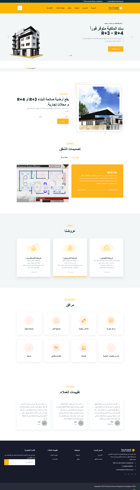
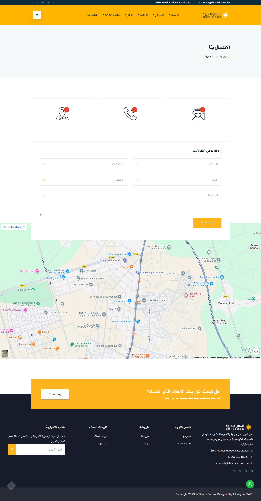

# 🏡 Shems Deroua (شمس الدروة) - Real Estate Website

A responsive Arabic (RTL) real estate showcase website for **Shems Deroua**, a new residential development in Casablanca offering building plots (R+3 / R+4) and commercial units. Built with Laravel.

## 🚀 Features

- Fully responsive, RTL Arabic landing page
- Project presentation (plots R+3, R+4, commercial units, facilities)
- Apartment plans and layouts with tabbed view
- Offers section for individuals, developers and investors
- Project facilities (shops, sports fields, schools, clinics, mosques, cafes...)
- Customer testimonials slider
- Contact page with form
- Newsletter subscription (Mailchimp)

## 📸 Demo

📽️ **Demo Video:** _[Insert YouTube link if available]_

🌐 **Live Demo:** _[Insert deployed URL if available]_

## 🖼️ Screenshots

### Home Page


### Contact Page


## 🛠️ Technologies Used

- Laravel 8
- PHP 7.4+ / 8.x
- MySQL
- Blade templates
- Bootstrap, HTML5, CSS3, JavaScript
- Mailchimp API (newsletter)

## ⚙️ Installation

Requirements: PHP, Composer and MySQL (XAMPP, WAMP or Laragon work fine).

### 1. Clone the repo

```bash
git clone https://github.com/nourddine20/Les-Roches-Bensliman-Website.git
cd Les-Roches-Bensliman-Website
```

### 2. Install dependencies

```bash
composer install
```

### 3. Create the `.env` file and generate the app key

```bash
cp .env.example .env
php artisan key:generate
```

### 4. Configure the database

Create an empty database (for example `LesRochesBensliman_db`), then edit `.env`:

```env
DB_CONNECTION=mysql
DB_HOST=127.0.0.1
DB_PORT=3306
DB_DATABASE=LesRochesBensliman_db
DB_USERNAME=root
DB_PASSWORD=
```

### 5. Run the migrations

```bash
php artisan migrate
```

### 6. Start the server

```bash
php artisan serve
```

Visit http://127.0.0.1:8000

## 📧 Newsletter Setup (optional)

The newsletter form uses Mailchimp. Add your own API key and list ID in the subscribe configuration, and never commit real keys to the repository.

## 📂 Folder Structure

```
app/
├── Http/
├── Models/
database/
├── migrations/
docs/
├── screenshots/        # README images
public/
├── frontside/assets/   # CSS, JS, images, PHP scripts
resources/
├── views/              # Blade templates
routes/
├── web.php
.env
```

## 📞 Contact (Project)

- 📍 6bis rue des tilleuls, Casablanca
- 📱 +212 668 194 832
- ✉️ contact@shemsderoua.ma

## 📄 License

This project is open-source and free to use for educational and personal purposes.

## 🙋‍♂️ Author

Developed by **Noureddine**
📧 aharbachnoureddine@gmail.com
🔗 [GitHub Profile](https://github.com/nourddine20/)

Original design by [Jokesigner SARL](https://jokesigner.com/)
